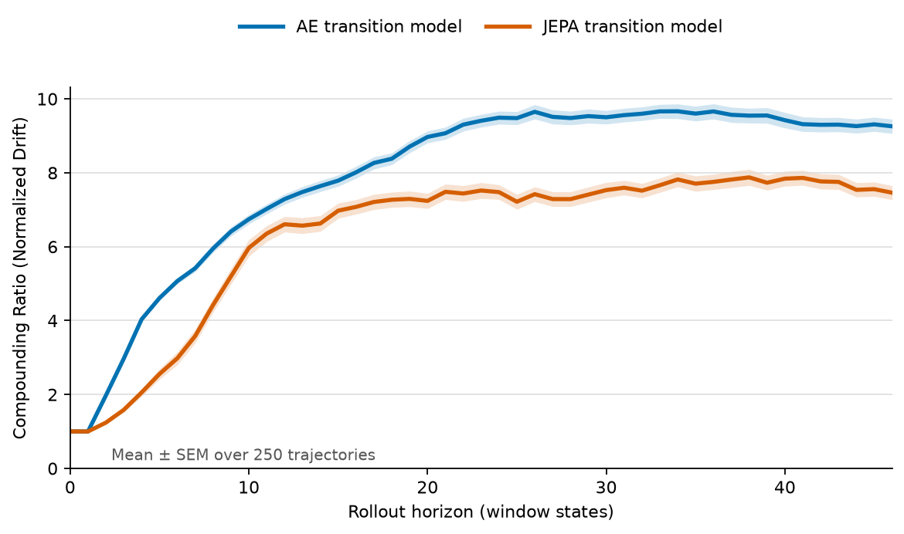
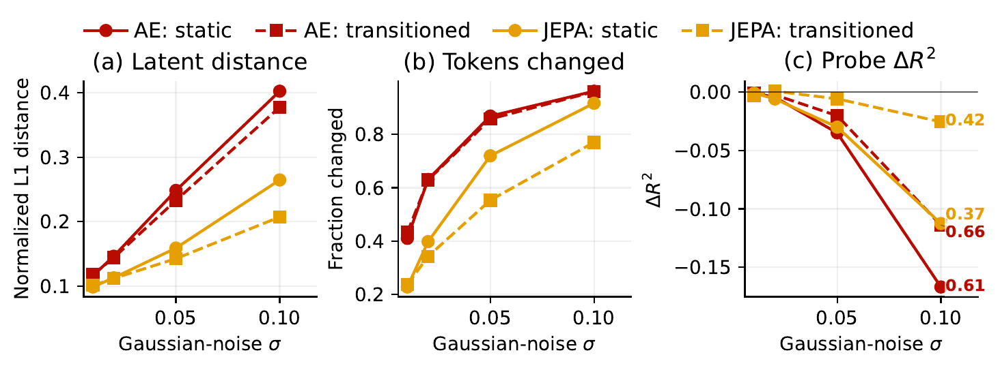
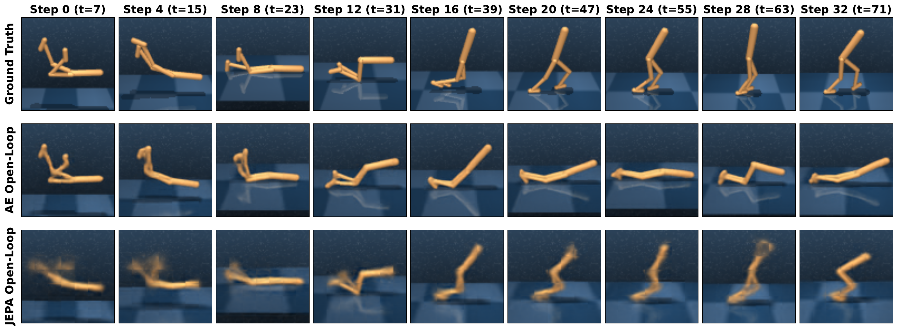

# Reconstruction vs. Prediction Pre-Training of Discrete Video Representations for Continuous Control

[](https://arxiv.org/abs/2611.24781)

**Ron Kosova** (University of Helsinki) & **Francesco Croce** (ELLIS Institute Finland, Aalto University)

Official codebase for *Reconstruction vs. Prediction Pre-Training of Discrete Video Representations for Continuous Control*.

---

## Overview

This repository isolates the effect of self-supervised pre-training objective—**pixel reconstruction (AE)** vs. **latent feature prediction (V-JEPA)**—on downstream dynamics in continuous control (DeepMind Control **Walker**).

To make the comparison capacity- and architecture-matched:
- Both encoders use an identical **4.9M-parameter time-causal ViViT Model 1** backbone over $8 \times 3 \times 84 \times 84$ clips (tubelets of size $2 \times 12 \times 12 \rightarrow 196$ tokens).
- Both share a **Finite Scalar Quantization (FSQ)** discrete bottleneck with levels $L = [9, 9, 9, 5, 5, 5]$ ($91{,}125$ codes, ~99% codebook utilization).
- For V-JEPA, we introduce a simple **asymmetric FSQ bottleneck**: the online student applies full FSQ rounding while the EMA teacher applies only FSQ's bounded continuous transformation $\lfloor L_i / 2 \rfloor \tanh(z_i)$, exposing the student to discrete codes while keeping continuous prediction targets.

---

## Key Results

### State/Policy Decoding, Local Dynamics & Temporal Context Dependence

| Encoder | State $R^2$ ($\uparrow$) | Action $R^2$ ($\uparrow$) | 1-Step Transition $L_1$ ($\downarrow$) | Mean Rollout CR ($\downarrow$) | Context Shift $D_2^{\text{ctx}}/D_2^{\text{adj}}$ | $D_3^{\text{ctx}}/D_3^{\text{adj}}$ | $D_4^{\text{ctx}}/D_4^{\text{adj}}$ |
| :--- | :---: | :---: | :---: | :---: | :---: | :---: | :---: |
| **AE** | **0.78** | **0.44** | **0.19** | 8.0 | 0.11 | 0.04 | 0.06 |
| **JEPA** | 0.47 | 0.23 | 0.21 | **6.5** | **0.91** | **0.84** | **0.89** |

- **Long-horizon dynamics:** Despite comparable 1-step transition error, the transition model trained on JEPA latents accumulates less compounding error across 47-step open-loop rollouts.



- **Visual perturbation robustness:** Under additive Gaussian noise, JEPA latents exhibit lower normalized $L_1$ drift, fewer flipped discrete tokens, and smaller state-probe $\Delta R^2$ degradation both statically and after one transition.



- **Decoded open-loop rollouts (Appendix C):** Comparing the jointly trained AE decoder against a post-trained JEPA decoder over a 32-step open-loop rollout.



---

## Repository Structure

```text
.
├── rvsablation/                     # Core package (ViViT encoder, FSQ, AE, V-JEPA, dataset & masking utils)
├── ae_conf/                         # AE encoder & decoder architecture configs
├── jepa_conf/                       # V-JEPA encoder & predictor architecture configs
├── train.py                         # Unified CLI entrypoint for AE and V-JEPA pre-training
├── train_ae.py                      # Autoencoder training loop
├── train_jepa.py                    # V-JEPA training loop (asymmetric FSQ + variance-floor reg)
├── extract_latents.py               # Extract frozen clip latents (for state & action probes)
├── extract_ordered_traj_latents.py  # Extract sliding-window transition pairs (for transition & context probes)
├── notebooks/                       # Downstream probes, structural analyses, and figure generation
└── pics/                            # Paper figures (PDF & PNG)
```

---

## Installation

Requires **Python >= 3.11** and a CUDA-capable GPU (all encoders in the paper were trained on a single 12 GB RTX 3060).

```bash
git clone <repo-url>
cd reprod_vs_semantic
pip install -e .
```

To also install dependencies for the evaluation notebooks (`matplotlib`, `jupyter`, `matrepr`):

```bash
pip install -e ".[notebooks]"
```

---

## Data Layout

Trajectories are collected from four SAC checkpoints in DMC Walker (`84x84` RGB frames, 100 frames per trajectory) and stored as HDF5 files under `data/walker_trajs_h5/`:

- `data/walker_trajs_h5/data.h5` — **25,000** trajectories used for encoder pre-training (12 eight-frame clips/trajectory, 90/10 split).
- `data/walker_trajs_h5/state_t4165_f100_r84_s43.h5` — **4,165** held-out trajectories used for all downstream probes (70/30 split).

---

## Reproducing the Experiments

### 1. Pre-Train Encoders

Hyperparameters match Table 3 of the paper (configs in `ae_conf/` and `jepa_conf/`):

```bash
# Autoencoder (AE)
python train.py \
  --model ae \
  --name fsq_videovae_run_1 \
  --epochs 100 \
  --warmup 10 \
  --batch 350 \
  --lr 2e-4 \
  --dataset-path ./data/walker_trajs_h5/data.h5

# V-JEPA (asymmetric FSQ)
python train.py \
  --model jepa \
  --name fsq_v_jepa_run_1 \
  --epochs 150 \
  --warmup 15 \
  --batch 400 \
  --lr 2e-4 \
  --var-reg 0.5 \
  --dataset-path ./data/walker_trajs_h5/data.h5
```

Checkpoints and configs are saved under `ae_runs/<run_name>/` and `jepa_runs/<run_name>/`.

### 2. Extract Frozen Representations

```bash
# Clip-level latents for state & action linear probes
python extract_latents.py --model ae --run-name fsq_videovae_run_1
python extract_latents.py --model jepa --run-name fsq_v_jepa_run_1

# Ordered sliding-window transition pairs for dynamics & context-shift probes
python extract_ordered_traj_latents.py --model ae --run-name fsq_videovae_run_1
python extract_ordered_traj_latents.py --model jepa --run-name fsq_v_jepa_run_1
```

### 3. Run Downstream Probes & Analyses

| Notebook | Paper Section / Figure | Description |
| :--- | :--- | :--- |
| [`notebooks/util_probe.ipynb`](notebooks/util_probe.ipynb) | Sec. 2 | FSQ codebook utilization (%) and perplexity |
| [`notebooks/state_probe.ipynb`](notebooks/state_probe.ipynb) | Sec. 3.1, Table 1 | Linear probe for 24-dim physical state ($R^2$) |
| [`notebooks/action_probe.ipynb`](notebooks/action_probe.ipynb) | Sec. 3.1, Table 1 | Linear probe for 6-dim SAC action ($R^2$) |
| [`notebooks/transition_probe.ipynb`](notebooks/transition_probe.ipynb) | Sec. 3.1, Table 1 | Train & evaluate 10.6M-param window transition Transformer |
| [`notebooks/window_state_rollout_probe.ipynb`](notebooks/window_state_rollout_probe.ipynb) | Sec. 3.2, Figs. 1 & 5 | Multi-step open-loop rollout error & compounding ratio |
| [`notebooks/context_shift_probe.ipynb`](notebooks/context_shift_probe.ipynb) | Sec. 3.3, Table 2 | Context-induced shift $D_i^{\text{ctx}} / D_i^{\text{adj}}$ across temporal groups |
| [`notebooks/perturbation_probe.ipynb`](notebooks/perturbation_probe.ipynb) | Sec. 3.3, Fig. 2 | Gaussian-noise & blur sensitivity (latent drift, token flips, $\Delta R^2$) |
| [`notebooks/jepa_decoder_post_training.ipynb`](notebooks/jepa_decoder_post_training.ipynb) | App. C, Fig. 6 | Post-train pixel decoder on frozen V-JEPA & visualize open-loop rollouts |
| [`notebooks/utils.ipynb`](notebooks/utils.ipynb) | App. A.2, Fig. 4 | Multi-block 3D tubelet masking & patchification sanity checks |

---

## Citation

If you find this code or paper useful, please cite:

```bibtex
@misc{kosova2026reconstructionvsprediction,
  title         = {Reconstruction vs. Prediction Pre-Training of Discrete Video Representations for Continuous Control},
  author        = {Ron Kosova and Francesco Croce},
  year          = {2026},
  eprint        = {2611.24781},
  archivePrefix = {arXiv},
  primaryClass  = {cs.LG},
  url           = {https://arxiv.org/abs/2611.24781}
}
```
